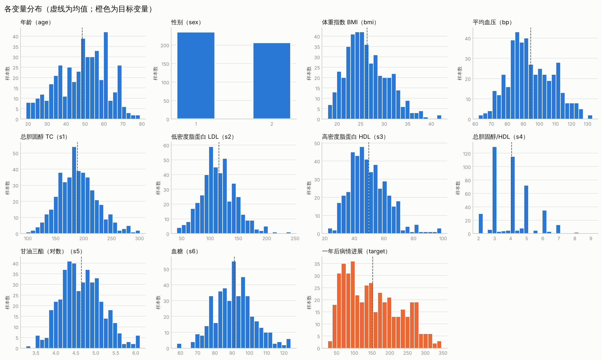
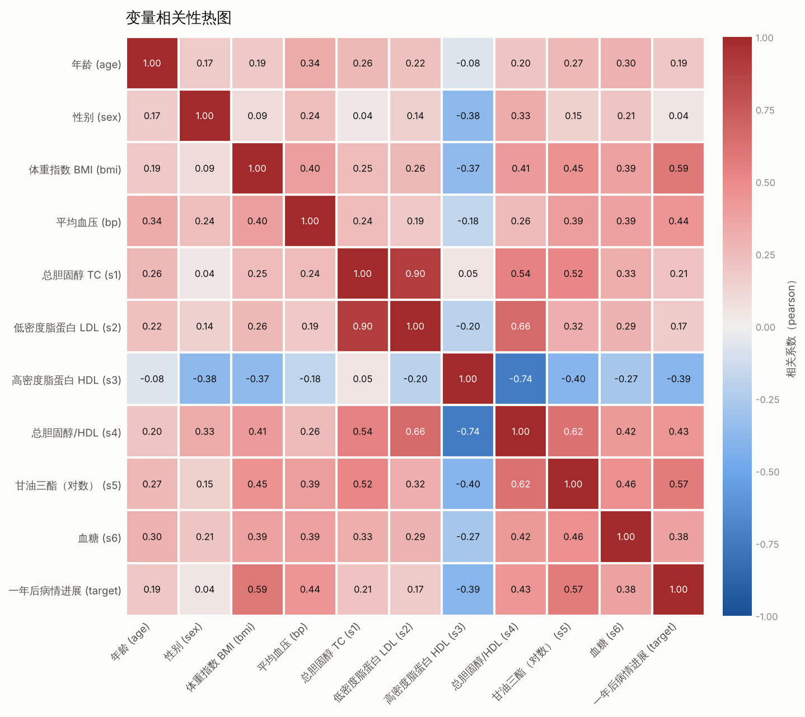
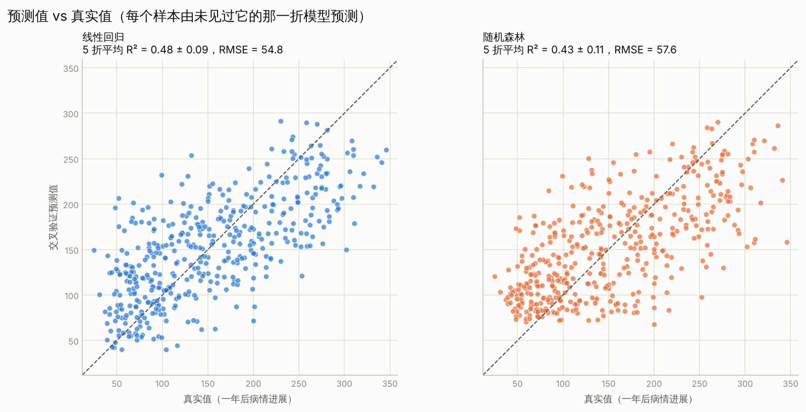
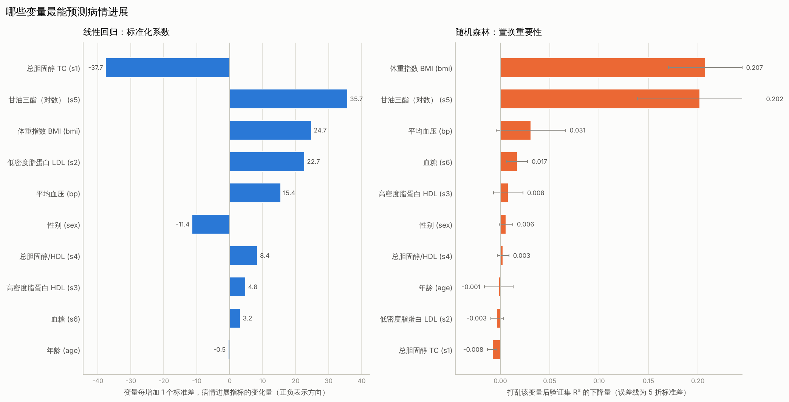

# 哪些变量最能预测糖尿病病情进展？——线性回归与随机森林的比较

> 本报告中的所有数字均来自 `python -m src.run_eda` 和 `python -m src.run_modeling` 实际运行生成的 `results/tables/` 下的表格（逐折得分之差、相关系数等少量派生数字已在文中注明来源）。重新运行这两条命令即可复现。

## 1. 研究问题

在 sklearn 自带的糖尿病数据集中，**哪些基线变量最能预测患者一年后的病情进展？** 具体做两件事：

1. 分别用线性回归和随机森林建模，用 5 折交叉验证比较两者的预测表现。
2. 给出各变量的系数和重要性排名，看两个模型的结论是否一致。

## 2. 数据

数据来自 `sklearn.datasets.load_diabetes`（Efron 等人，2004），共 **442 名患者、11 个变量，没有缺失值**（`diabetes_describe.csv`）：

| 变量 | 含义 | 均值 | 标准差 | 范围 |
|---|---|---|---|---|
| age | 年龄（岁） | 48.52 | 13.11 | 19 – 79 |
| sex | 性别（编码 1 / 2，数据集未说明对应关系） | 1.47 | 0.50 | 1 – 2 |
| bmi | 体重指数 | 26.38 | 4.42 | 18.0 – 42.2 |
| bp | 平均血压 | 94.65 | 13.83 | 62 – 133 |
| s1 | 总胆固醇 TC | 189.14 | 34.61 | 97 – 301 |
| s2 | 低密度脂蛋白 LDL | 115.44 | 30.41 | 41.6 – 242.4 |
| s3 | 高密度脂蛋白 HDL | 49.79 | 12.93 | 22 – 99 |
| s4 | 总胆固醇 / HDL | 4.07 | 1.29 | 2 – 9.09 |
| s5 | 甘油三酯（可能取对数） | 4.64 | 0.52 | 3.26 – 6.11 |
| s6 | 血糖 | 91.26 | 11.50 | 58 – 124 |
| **target** | **一年后病情进展指标（预测目标）** | **152.13** | **77.09** | **25 – 346** |

各变量的分布见下图（虚线为均值，橙色为目标变量）。s4 的取值集中在少数几个整数上，更像离散变量；目标变量略右偏（偏度 0.44）。

变量之间的相关性见下图（`diabetes_correlation.csv`）：

与目标变量相关性最强的是 bmi（0.59）和 s5（0.57），其次是 bp（0.44）、s4（0.43）和 s3（-0.39）；sex 几乎无相关（0.04）。特征之间存在明显共线性：**s1 与 s2 的相关系数为 0.90，s3 与 s4 为 -0.74**，这会影响后面对模型系数的解读。

## 3. 方法

- **数据**：使用原始单位（`load_diabetes(scaled=False)`），便于解读。
- **线性回归**：先对特征做标准化再拟合普通最小二乘，这样各变量的系数（`coef_std`，变量每增加 1 个标准差时目标的变化量）可以直接比较大小。同时给出原始单位下的系数（`coef_raw`）。
- **随机森林**：`RandomForestRegressor`，300 棵树，其余超参数为 sklearn 默认值，**没有针对本数据集调参**。
- **交叉验证**：两个模型使用同一组 5 折划分（`KFold`，打乱，`random_state=42`），报告 R²、RMSE、MAE 的 5 折均值和标准差。散点图中的预测值是交叉验证预测值——每个样本都由没见过它的那一折模型预测。
- **变量重要性**：
  - 线性回归：按标准化系数的绝对值排名。系数在全部 442 个样本上拟合得到。
  - 随机森林：**置换重要性**。在每一折的验证集上逐个打乱变量，计算 R² 的下降量（每个变量重复 10 次），再对 5 折取均值和标准差。同时保留基于训练数据的不纯度重要性（`impurity` 列）作参考。
  - 综合排名：两个模型各自排名的平均值。
- **环境**：Python 3.13.16，scikit-learn 1.9.1。

## 4. 结果

### 4.1 预测表现

5 折交叉验证结果（`cv_scores_summary.csv`，括号内为 5 折标准差）：

| 模型 | R² | RMSE | MAE |
|---|---|---|---|
| 线性回归 | 0.4785（0.0950） | 54.85（2.95） | 44.27（2.92） |
| 随机森林 | 0.4271（0.1055） | 57.56（3.94） | 46.78（3.74） |

作为参照，目标变量本身的标准差为 77.09。两个模型都只能解释目标变量约 43%–48% 的方差。

逐折来看（`cv_scores_by_fold.csv`，R² 之差由该文件计算）：线性回归在 5 折中的 4 折优于随机森林，R² 之差分别为 +0.019、+0.039、+0.137、+0.101 和 -0.040，平均高出 0.051。平均差距小于各折自身的标准差（约 0.1），所以只能说线性回归**略好或持平**，不能认为两者有可靠差异。

散点图显示两个模型的预测值都明显偏离对角线，随机森林在真实值较低的样本上倾向于高估（右图左下方的点大多落在对角线上方）。

### 4.2 变量重要性

各变量的系数、重要性与排名（`feature_ranking.csv`，按平均排名升序）：

| 变量 | 含义 | 标准化系数 | 原始单位系数 | 线性排名 | 置换重要性（R² 下降量）± 标准差 | 森林排名 | 平均排名 |
|---|---|---|---|---|---|---|---|
| bmi | 体重指数 | 24.73 | 5.60 | 3 | 0.2075 ± 0.0373 | 1 | 2.0 |
| s5 | 甘油三酯 | 35.73 | 68.48 | 2 | 0.2019 ± 0.0631 | 2 | 2.0 |
| bp | 平均血压 | 15.43 | 1.12 | 5 | 0.0309 ± 0.0351 | 3 | 4.0 |
| s1 | 总胆固醇 | -37.68 | -1.09 | 1 | -0.0082 ± 0.0048 | 10 | 5.5 |
| sex | 性别 | -11.41 | -22.86 | 6 | 0.0058 ± 0.0068 | 6 | 6.0 |
| s6 | 血糖 | 3.22 | 0.28 | 9 | 0.0171 ± 0.0105 | 4 | 6.5 |
| s3 | 高密度脂蛋白 | 4.81 | 0.37 | 8 | 0.0080 ± 0.0149 | 5 | 6.5 |
| s2 | 低密度脂蛋白 | 22.68 | 0.75 | 4 | -0.0034 ± 0.0062 | 9 | 6.5 |
| s4 | 总胆固醇/HDL | 8.42 | 6.53 | 7 | 0.0028 ± 0.0059 | 7 | 7.0 |
| age | 年龄 | -0.48 | -0.04 | 10 | -0.0015 ± 0.0145 | 8 | 9.0 |

主要发现：

1. **bmi 和 s5 是最重要的两个变量。** 它们在随机森林中的置换重要性（0.2075、0.2019）都在第三名 bp（0.0309）的 6 倍以上，在线性回归中也都是系数较大且为正的变量（标准化系数 24.73、35.73），两个模型的结论一致。方向上，BMI 越高、s5 越高，病情进展越快：原始单位下，BMI 每增加 1 个单位，进展指标平均增加 5.60。
2. **bp 排第三，但证据较弱。** 它的置换重要性（0.0309）小于其 5 折标准差（0.0351），不能与 0 明确区分。
3. **其余变量的预测贡献都很小。** 置换重要性大多在 0.02 以下，且多数小于自身标准差；age 的标准化系数仅为 -0.48，置换重要性为 -0.0015。
4. **线性回归的系数排名在这里不可靠。** s1 的标准化系数最大（-37.68，线性排名第 1），s2 也排在第 4（22.68）。但二者相关系数高达 0.90，线性回归会把它们的作用相互抵消，使系数一正一负且被放大；在随机森林里，s1 和 s2 的置换重要性都为负（-0.0082、-0.0034），说明它们对没见过的数据几乎没有预测贡献。因此比较变量的预测贡献时，应以验证集上的置换重要性为准。

## 5. 局限性

- **样本量小、数据单一。** 只有 442 个样本、一个数据集，结论是否能推广到其他人群未知。
- **模型表现有限。** 两个模型的 R² 都不到 0.5，说明这 10 个基线变量只能解释病情进展的一部分变异，大部分变异由数据中没有的因素决定。
- **没有调参，也没有嵌套交叉验证。** 随机森林使用默认超参数，调参后表现可能变化；两个模型的差距小于折间波动，本报告不能判断哪个模型更好。
- **5 折结果的波动仅反映一组划分。** 报告的标准差是同一组 5 折划分内部的波动，不是置信区间；更换随机种子或增加重复次数可能改变排名靠后变量的相对顺序。
- **共线性影响重要性的解读。** s1、s2、s3、s4 之间高度相关，置换重要性在相关变量之间会被分摊或低估，排名靠后的变量不等于"与病情无关"。线性回归的系数也没有给出置信区间。
- **性别编码未知。** 数据集只给出 1 和 2 两个取值，未说明对应关系，因此 sex 的系数方向无法直接解读。
- **没有检验非线性和交互作用。** 随机森林虽然能捕捉非线性，但本研究没有进一步分析变量间的交互或非线性形状。
- **预测关联不等于因果。** 结果只说明哪些变量与病情进展的关系最紧密，不能推出干预这些变量就能改变病情进展。

## 6. 结论

1. **BMI 和甘油三酯（s5）是最能预测病情进展的变量。** 两个模型一致认为它们最重要，且都是正向关系；随机森林中打乱其中任何一个，验证集 R² 下降约 0.20。
2. 平均血压（bp）可能有一定预测价值，但证据较弱；其余变量的预测贡献都很小。
3. 线性回归（R² 0.4785）与随机森林（R² 0.4271）表现接近，线性回归略好但差距小于折间波动。两个模型都只能解释约一半的方差。
4. 在高度共线的变量（如 s1 与 s2）上，线性回归的系数不应直接解读，建议结合验证集上的置换重要性判断。

后续可考虑：对随机森林调参并使用嵌套交叉验证、用多个随机种子重复交叉验证、对共线变量做分组或正则化（如岭回归、Lasso），以及检验 BMI 与 s5 的非线性关系。
